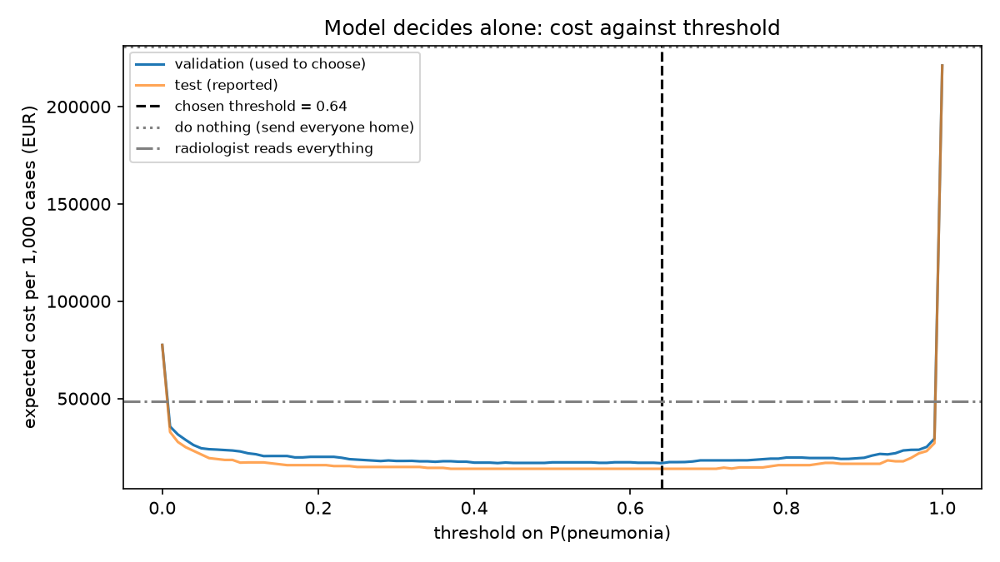

# Assignment 2 Report

- **Name**: Leopoldo Sirolli
- **Student ID**: 19170
- **Email**: lsirolli.ieu2022@student.ie.edu    
- **Group**: BBADBA 5A

## Business problem, and the cost of being wrong

I decided to focus this assignment on a medical evnironment as this is the first area that came to mind where assymentry is important and where a flase negative can be catastrophic. 

In this case I decided to choose a pediatric emergency department, when a child is suspected to have pneumonia he gets a chest X-ray and the doctor has three choices:
- send home
- treat pneumonia
- send the x-ray to a radiologist

My costs assumptions are the following: 
- cost_fn: 1400,
- cost_fp: 80,

Essentially a FN (missed pneumonia), meaning the child got sent home sick costs about EUR 1,400 = repeat ED visit 246€ + 30% chance of admission x 3,804

False alarm, (FP) costs
EUR 80 = GP follow-up + treatment + resistance cost

Ratio is 17, a false negative costs 17 more times on avergae than a false positive

1) Who acts on the model's output? 
The emergency doctor acts first. They see the model’s answer and either send the child home (pass) or prescribe antibiotics (fail). The radiologist only sees the uncertain cases in the middle band, about 1 a day in your setup. That’s the point of the design: the radiologist isn’t needed for most children.

2) Why is a miss worse than a false alarm, beyond the euros? 
A miss in this case is way worse than a false alarm. A young child who gets left untreated with pneumonia can get worse quickly: trouble breathinbg, eventually longer hospital stay and in rare cases death. A healthy child that gets antibiotics when not needed instead has a few days of side effects at worse. One mistake can be huge here.

3) Which metric does that make you care about most?
The metric we are going to use is RECALL for pneumonia and out of all the sick children how many does our model get correct?

## Dataset

- Roboflow Universe: workspace `chestxrayimages`, project `pneu-detect`, version `2`
- Link: https://universe.roboflow.com/chestxrayimages/pneu-detect/dataset/2
- Task: image classification. One image = one frontal chest X-ray of one child
- Classes: BACTERIA (bacterial pneumonia), VIRUS (viral pneumonia), NORMAL
- Origin: the filenames (`person1005_virus_1688`, `IM-0141-0001`) match the public dataset of Kermany et al., Cell 2018: children aged 1 to 5 from Guangzhou Women and Children’s Medical Center.
- Roboflow preprocessing: auto-orient, stretched to 640 x 640, no augmentation.

This dataset fits my problem as it asnwers a similar quesiton and takes a decision that a doctor would have to take, loomks at an X-ray and makes a call, in this case Children X-Rays. 
The correct answer for each X-ray has been decided by two expert doctors that labelled each instance which was then tripled checked with the test ones. 
Xrays were taking by hospital in Guangzhou in China with chidlren aged 1 to 5 max. 
In the dataset aobut 73% of the xrays have pneumonia as it was built to show examples of this. An ED sees moslty healthy children our (16.5%).

## What the dataset's composition implies

| class | train | val | test | total |
|---|---|---|---|---|
| BACTERIA | 1,746 | 516 | 258 | 2,520 |
| NORMAL | 925 | 280 | 143 | 1,348 |
| VIRUS | 961 | 265 | 120 | 1,346 |
| **total** | **3,632** | **1,061** | **521** | **5,214** |

- Class shares are about the same in every split: ~48% BACTERIA, ~26% NORMAL, ~26% VIRUS,
  so pneumonia is ~73% of the data.
- Object size: not applicable. This is classification, so the whole X-ray is the input.
  Images are stretched to 640 x 640 by Roboflow and the model reads them at 224 x 224.
- The 5,214 images come from 2,861 children (~1.8 images per child). 56% of test images
  belong to a child who also has an X-ray in the training set (cell 3).
- Checked on the 228 test X-rays from children never seen in training (cell 7b):

| test subset | images | pneumonia caught | healthy cleared | viral recall |
|---|---|---|---|---|
| all test | 521 | 99.2% | 97.9% | 55.0% |
| children never seen in training | 228 | 99.1% | 97.5% | 66.7% |

The main result, only 0.8% of pneumonia cases sent home, is based on just 3 missed children out
of 378. With so few cases the real miss rate could be anywhere from about 0.3% to 2.3%. The false
alarms are the same: 3 out of 143 healthy children, so the real rate could be anywhere from 0.7%
to 6%. The bacterial vs viral split is even thinner, as only 36 viral cases come from children
the model never saw in training.

The test split does not look like real life. All the X-rays come from one hospital in Guangzhou,
only children aged 1 to 5, the bad scans were removed, and 73% have pneumonia, much more than a
real emergency department sees. The test set is a random part of the same data, so it shows how
the model does on more of the same, not on a new hospital, new machines or different patients.

So I cannot promise the same accuracy in a Madrid hospital, with different machines, older or
younger children, worse scans and far fewer pneumonia cases, which would also mean more of the
alarms are false. I also cannot give 0.8% as the exact miss rate, only as a rough estimate.
Having the same children in train and test does not really change the pneumonia vs normal result:
on children the model never saw, it missed 1 of 108 pneumonia cases (0.9%, vs 0.8% overall) and
cleared 97.5% of healthy children (vs 97.9%). Viral recall was actually higher on these children
(66.7% vs 55.0%), so the overlap does not inflate that either. The viral number is just limited
by having few cases.

## Finetuning and baselines

**Model:** yolo11n-cls (YOLO11 nano image classifier), pretrained on ImageNet, finetuned on the
training split. Settings: image size 224, batch 32, up to 30 epochs with early stopping
(patience 10), seed 0, horizontal flipping turned off. Trained on my MacBook Air using the
Apple GPU (PyTorch "mps"), about 30 seconds per epoch. Training stopped after epoch 29; the
best validation accuracy (0.815) was at epoch 19, and those weights are the ones saved in
`weights/`.

Results on the same test split (521 X-rays):

| model | 3-class accuracy | pneumonia caught | pneumonia precision | healthy cleared |
|---|---|---|---|---|
| finetuned yolo11n-cls | 0.820 | 0.992 | 0.992 | 0.979 |
| trivial baseline (always predicts BACTERIA) | 0.495 | 1.000 | 0.726 | 0.000 |
| pretrained model, zero-shot | 0.274 | 0.000 | 0.000 | 1.000 |

The pretrained classifier was trained on ImageNet rather than COCO, and none of its 1,000 classes
is medical, so zero-shot it can never flag pneumonia. Its most common labels for the test X-rays
were "radiator" (230), "water bottle" (113) and "isopod" (46).

I used classification and not detection. Detection draws boxes around objects, like a car or a
crack, while classification gives one answer for the whole image. One answer is exactly what
the doctor needs: for each child, pneumonia or not. One score per X-ray also fits directly into
my pass / review / fail decision. Pneumonia is not a sharp object you can put a box around, it
is a cloudy area spread over the lungs. And the dataset only has one label per image and no
boxes, so detection was not possible anyway.

The trivial baseline catches every sick child, but only because it calls every child sick, so
it clears none of the healthy ones. My finetuned model catches 99.2% of pneumonia cases and
still clears 97.9% of healthy children. The zero-shot model fails completely, as it has never
seen an X-ray class in training. I expected a big gap, because pneumonia vs normal is quite
visible on an X-ray, where infected areas show up as white patches. The 82% three-class
accuracy is lower because telling bacterial from viral pneumonia is hard even for doctors.

## Per-class evaluation and failure modes

Positive class: pneumonia (BACTERIA + VIRUS). Negative class: NORMAL.
Per-class results on the test split (predicted class = highest probability):

| class | precision | recall | F1 | test images |
|---|---|---|---|---|
| BACTERIA | 0.804 | 0.857 | 0.829 | 258 |
| NORMAL | 0.979 | 0.979 | 0.979 | 143 |
| VIRUS | 0.641 | 0.550 | 0.592 | 120 |

Confusion matrix (rows = true class, columns = predicted class):

| true \ predicted | BACTERIA | NORMAL | VIRUS |
|---|---|---|---|
| BACTERIA | 221 | 2 | 35 |
| NORMAL | 1 | 140 | 2 |
| VIRUS | 53 | 1 | 66 |

1) Which class carries the headline number?
The headline number comes from the NORMAL class. In the confusion matrix only 3 healthy children
were called pneumonia, and only 3 sick children (2 bacterial, 1 viral) were called normal. So the
model is excellent at the one split our decision needs: normal vs any pneumonia. That is where
the 99.2% of pneumonia caught and the 97.9% of healthy children cleared come from.

2) Which class is dragging?
The viral class. The model finds only 55% of viral cases, and its precision is the lowest of the
three at 0.641, so when it says "viral" it is wrong about a third of the time.

3) What does it confuse with what, and where does it break?
Almost all the errors are bacterial and viral mixed up: 53 viral cases were called bacterial and
35 bacterial cases were called viral. In our setup this does not change the pass / review / fail
decision, because both count as pneumonia and both get treated. It would matter if a doctor used
the model to decide who gets antibiotics, since antibiotics only help bacterial pneumonia. Then
44% of viral cases would get antibiotics they do not need, adding side effects and resistance,
and 14% of bacterial cases could miss the treatment they need. This is where it breaks: the model
is reliable for detecting pneumonia, but not for choosing the treatment, which still needs a
doctor's judgement or extra tests.

## Cost matrix and operating point

| outcome | cost per child | where it comes from |
|---|---|---|
| missed pneumonia (sent home sick) | €1,400 | repeat ED visit €246 (La Rioja public prices, 2025) + 30% chance of admission × €3,804 (Madrid Orden 1975/2023, APR-GRD 139 "Otra neumonía", severity 2) |
| false alarm (healthy child treated) | €80 | GP follow-up €61 (Cantabria public prices, 2025) + amoxicillin ~€4 + antibiotic-resistance cost ~€15 (Shrestha et al. 2018: ~$0.6 per dose unit × ~25 units) |
| pneumonia correctly treated | €65 | antibiotics + GP follow-up |
| healthy child correctly sent home | €0 | |
| one radiologist read | €10 | estimate: ~5 minutes at ~€52/hour including social security |

**Base rate:** 16.5% of children X-rayed for suspected pneumonia actually have it (Lipsett et al.,
Pediatrics 2018: 113 of 683 children). Error rates are measured separately on sick and healthy
test children, then weighted by 16.5% instead of the dataset's 73%.

| assumption changed | value | cheapest threshold | test cost per 1,000 |
|---|---|---|---|
| cost of a miss | €500 | 0.88 | €12,901 |
| cost of a miss | €1,000 | 0.64 | €13,351 |
| cost of a miss | **€1,400 (mine)** | **0.64** | **€13,875** |
| cost of a miss | €2,500 | 0.43 | €15,315 |
| cost of a miss | €4,000 | 0.28 | €18,214 |
| cost of a false alarm | €40 | 0.43 | €13,174 |
| cost of a false alarm | €160 | 0.64 | €15,276 |
| base rate | 8% | 0.64 | €7,592 |
| base rate | 27% | 0.43 | €21,636 |

1) The operating point
I chose a threshold of 0.64. To find it, I tried every threshold from 0.00 to 1.00 in steps of
0.01 on the validation split, took the cheapest one, and then reported its cost on the test split,
so the number is not tuned on itself. At 0.64 the expected cost is €13,875 per 1,000 children,
with about 1.3 sick children missed and 17.5 healthy children treated for nothing. On the
validation split the cost curve is flat between about 0.40 and 0.64 (all within 2% of the
minimum), so the exact choice inside that range matters little.

2) The assumption that matters most
The result is most sensitive to the cost of a miss, which is also my weakest assumption, because
it rests on my own estimate of a 30% chance of admission after a missed case. The threshold stays
at 0.64 for a miss costing €1,000 to €1,400, but drops to 0.43 at €2,500 and to 0.28 at €4,000.
So if missed cases are more serious than I assumed, the model should flag children more easily.
The base rate matters too: 0.64 holds from 8% to 16.5%, but if the real rate were closer to 27%,
as it would be if Lipsett's equivocal X-rays counted as pneumonia, the threshold would also drop
to 0.43.

## What a person still has to check
**Thresholds** (chosen on the validation split as the cheapest pair, then reported on test):
pass (send home) below **0.28**, fail (treat) at or above **0.98**, and everything in between
goes to a radiologist.

| | value |
|---|---|
| share of cases sent to a radiologist | 3.7% |
| X-rays per day at the site (assumed) | 30 |
| reviews per day | 1.1 |
| time per review (assumed) | 5 minutes |
| radiologist time needed | ~6 minutes a day |
| radiologist time available (assumed) | 1 radiologist × 2 hours a day = up to 24 reviews |

Test X-rays by outcome:

| true class | pass (sent home) | review (radiologist) | fail (treated) |
|---|---|---|---|
| NORMAL | 138 | 5 | 0 |
| BACTERIA | 2 | 8 | 248 |
| VIRUS | 1 | 10 | 109 |

My design against the alternatives (test split, per 1,000 children at a 16.5% base rate):

| option | cost | sick children missed | healthy children treated | sent to radiologist | radiologist time a day |
|---|---|---|---|---|---|
| do nothing (send everyone home) | €231,000 | 165 | 0 | 0% | 0 |
| radiologist reads everything | €48,439 | 8.3 | 208.8 | 100% | 2.5 hours |
| model decides alone (t = 0.64) | €13,875 | 1.3 | 17.5 | 0% | 0 |
| **model + review band (0.28 to 0.98)** | **€13,952** | **1.7** | **7.3** | **3.7%** | **~6 minutes** |

1) Is it realistic?
Yes, comfortably. With 3.7% of cases sent for review and 30 X-rays a day, the radiologist sees
about 1 X-ray a day, roughly 6 minutes of work out of the 2 hours I assumed are available (up to
24 reviews). Reading every X-ray would take about 2.5 hours a day, more than that slot, so the
band is far below the limit, and the spare capacity also covers the days when 3 or 4 cases
arrive at once.

2) Which design would I ship?
The model with the review band. Doing nothing sends home 165 sick children per 1,000, and a
radiologist reading everything costs more than three times as much as the model, mainly because
radiologists over-call pneumonia on children's X-rays, so about 209 healthy children per 1,000
get antibiotics. Between the model alone and the model with the band, cost does not separate
them: €77 apart on test, the band cheaper on validation, and both based on very few children.
What decides it is the trade-off: the band cuts healthy children treated from 17.5 to 7.3 per
1,000, at the price of slightly more misses (1.7 vs 1.3) from the radiologist's own errors, and
it puts a human on the 23 hardest X-rays for about 6 minutes a day, which makes the system safer
and easier for doctors to trust.

## Limitations & next steps

1) Data from one hospital
All the X-rays come from one hospital in China and from children aged
1 to 5, so I cannot promise the same accuracy in Madrid, where machines, protocols and patients
differ. Before using the model, I would test it on X-rays from a Spanish hospital, for example the
public PadChest dataset from Hospital San Juan in Alicante.

2) Too few errors to measure precisely.
 The 0.8% miss rate rests on only 3 children, so the true
rate could be anywhere from 0.3% to 2.3%, and the same small numbers affect the comparison between
my designs. I would use a much larger test set with more borderline cases, and report every result
with its range.

3) Viral pneumonia is poorly recognised.
 The model finds only 55% of viral cases (and only 36 come
from unseen children), so it cannot decide who gets antibiotics. I would keep its role to
"pneumonia or not" and, to go further, add more viral examples or combine the image with clinical
data such as fever and blood tests.

4) The cost of a miss is my own guess.
It is the assumption that moves the threshold most, and it
depends on my estimate that 30% of missed cases end up admitted. I would replace it with hospital
records on how many children sent home with missed pneumonia come back and are admitted.

5) The base rate comes from a US study.
The 16.5% from Lipsett et al. may differ in a Spanish
emergency department. I would measure it from the hospital's own records and rerun the threshold
choice.

6) Detail is lost in the images.
The X-rays are stretched to 640 x 640 and read at 224 x 224, so
shape and fine detail are lost, which may be part of why bacterial and viral cases get confused.
I would retrain at a higher resolution, such as 384 or 512, without stretching, and compare.

## Generative AI use disclosure

I used Claude (Anthropic), through the Claude app, throughout this assignment.

- Code:Claude aided with the code for the training pipeline, the dashboard and the cost functions, which the policy allows for this kind of
work. I ran it on my own computer and checked the outputs. The teacher's template files were
left unchanged.

- Problem and dataset: 
Claude helped me compare possible problems and datasets on Roboflow
Universe. I chose paediatric pneumonia triage and the `pneu-detect` v2 dataset.

- Cost figures: 
Claude helped me find published sources for the costs, base rate and
radiologist accuracy, and proposed values based on them. I reviewed them and chose to adopt
them, including the 30% admission assumption.

- Report:
Claude  helped edit my drafts for length and tone, correcting a few factual
errors. The decisions in the report, such as which design to ship and which limitations
matter, are my own.

- Setup: Claude helped me set up GitHub, VS Code and the Roboflow API key.